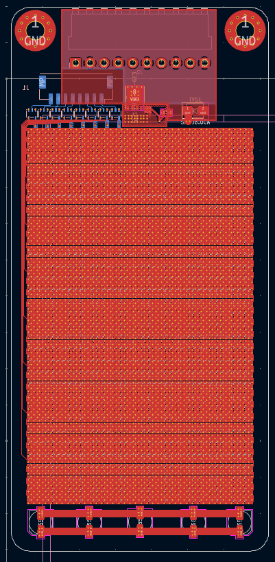

# Ultra-High-Density RGB Matrix Badge

A wearable RGB matrix badge featuring 2560 individually addressable LEDs on a 71 × 150 mm board with a 62.5 × 104 mm portrait display area.

## Project Overview

This project implements an ultra-dense LED matrix badge designed for human viewing (not camera-optimized) with parallel data lanes to achieve smooth 60+ FPS refresh rates. The design uses a two-board architecture separating the dense LED matrix from controller/power electronics for improved manufacturability and maintainability.

### Key Specifications

| Parameter | Value |
|-----------|-------|
| Display Area | 62.5 mm × 104 mm (portrait) |
| Resolution | 40 × 64 pixels (2560 total) |
| Board Size | 71 mm × 150 mm, 5 mm corner radius |
| Pixel Pitch | 1.5625 mm (X) × 1.625 mm (Y) |
| Target Refresh Rate | 60+ FPS |
| Power Source | USB-C PD Powerbank |
| Quantity | ~10 boards |
| PCB Tool | KiCad |

### Resolution Preview

A quick browser-based mockup of the 40 × 64 LED grid lives in [`mockup/`](mockup/). It cycles through 11 test animations (rainbow, plasma, sparkle, scrolling text, rings, matrix rain, A* snake, thumbs-up, pride flag, a multi-scene cat, and a video-driven Bad Apple) so you can sanity-check what 2560 LEDs at this pitch can actually display before writing firmware.

Run from the repo root:

```bash
python3 -m http.server -d mockup 8000
# then open http://localhost:8000/
```

Cycle with `←` / `→` arrow keys or the on-screen buttons; `space` pauses.

### Development Environment

`nix develop` provides KiCad (with `import pcbnew` working from plain Python), PlatformIO, ffmpeg and the linters. `nix flake show` lists the available commands.

Board layout changes are scripted in `cad/` and checked end to end (outline, lanyard holes, power-entry wiring, DRC with schematic parity) by:

```bash
python3 cad/test_board.py
```

Design decisions are recorded in [`docs/adr/`](docs/adr/).

## Hardware Architecture

### Two-Board Design

#### 1. Matrix PCB (`cad/led_bage.*`)



- Dense 64×40 LED array, 8 chains of 320 LEDs (refs `DA1`..`DH320`)
- 6-layer stackup: F.Cu | GND | VDD_S | VDD_S | GND | B.Cu, two fanout vias per LED
- Input protection on board: reverse-polarity P-FET (Si7145DP, drain on the input) + SMBJ6.0CA TVS, copper pours for the ~30 A input path ([ADR 0002](docs/adr/0002-reverse-polarity-power-entry.md))
- Connectors: J1 data (Molex CLIK-Mate 8-pin), J2 power (JST VH 10-pin, back side, cable exits the top edge)
- Rounded-rectangle outline with two 5 mm plated lanyard holes in a top band beside J2 ([ADR 0001](docs/adr/0001-board-outline-and-lanyard-mounting.md))
- Optimized for minimal rework risk

A 100-LED sample board (`cad/led_bage_sample/`) has been fabricated as a reference.

#### 2. Controller/Power PCB
- ESP32-S3 microcontroller
- USB-C Power Delivery circuitry
- Buck converter (PD voltage → 5V)
- 3.3V regulator for MCU
- Level shifters (3.3V → 5V for LED data)
- Power switch and protection
- Easy to iterate/upgrade without risking LED matrix

**Rationale:** Separating control from display allows safe iteration on USB/PD/MCU without risking the expensive, dense LED field.

## Component Selection

### LED: XINGLIGHT XL-1010RGBC-2812B

**Why this LED:**
- Cost: ~€0.03/pixel at volume (extremely competitive)
- Package: 1.0×1.0×0.8 mm (1010 SMD)
- Protocol: WS2812B-compatible (1-wire smart RGB)
- Supply: 3.5–5.5V (100% functional at 4.5–5.5V)
- PWM: ~1.0 kHz, 256 grayscale steps per channel
- Timing: ~1.2 µs per bit (~800 kbps class)

**Electrical Characteristics:**
- VDD: 3.5–5.5V (running at 5V)
- DIN VIH (min): 2.8V, VIL (max): 1.6V
- Optimized current: ~5 mA/channel → ~15 mA/pixel at full white
- Full array theoretical max: 2560 × 15 mA = 38.4A @ 5V (192W)

**Footprint Details:**
- 4× corner pads, 0.40 mm × 0.40 mm each
- Body-to-body clearance: ~0.56–0.63 mm at chosen pitch
- Minimal courtyard required for dense packing

### Microcontroller: ESP32-S3

**Selection criteria:**
- Sufficient GPIO for 8+ parallel data lanes
- DMA-capable for smooth LED updates
- Good headroom for complex animations
- 3.3V I/O (requires level shifting to 5V LEDs)
- Well-supported by Arduino/ESP-IDF ecosystems

### Power Architecture

#### Strategy: PD Negotiation → Buck Conversion

```
USB-C PD Powerbank (25000mAh, 145W class)
    ↓ (negotiated at 9V baseline, 12V/15V/20V optional)
Buck Converter
    ↓ (5V rail for LEDs)
LED Matrix (capped brightness in firmware)
    +
    ↓ (3.3V regulator)
ESP32-S3 + Logic
```

**PD Voltage Selection:**
- **Baseline: 9V PD** (maximum compatibility)
- Higher voltages (12V/15V/20V) reduce cable current but may not be universally available
- Buck converter sized for 8–12A continuous @ 5V (40–60W with safety margin)

**Rationale:**
- Reduces cable/connector current stress
- Provides stable 5V rail despite powerbank voltage
- Allows brightness capping in firmware to manage realistic power draw

## Data Distribution Architecture

### 8-Lane Parallel Design

**Mapping:**
- 8 data lanes, each driving 320 pixels
- Each lane: 8 rows × 40 columns, serpentine
- Lanes arranged as horizontal bands down the 64-row display

**Refresh Math (per lane):**
```
1 pixel = 24 bits × 1.2 µs ≈ 28.8 µs
320 pixels ≈ 9.22 ms
+ Reset time (>200 µs) ≈ 9.4–9.8 ms total
→ Max refresh ≈ 100+ FPS per lane
```

**Actual target:** 60 FPS with comfortable headroom

### Signal Integrity

#### Level Shifting
- ESP32 outputs: 3.3V logic
- LED inputs: require high VIH @ 5V supply
- Solution: Fast 3.3V→5V level shifters, one per lane

#### Series Resistors (Multi-Purpose Protection)

**At level shifter output:**
- 33–68Ω close to shifter
- Purpose: Signal integrity, prevent overshoot/ringing on short traces

**Optional at matrix connector:**
- 220–500Ω (stuff if needed)
- Purpose: Protection against live-plug transients, cable inductance
- Datasheet recommends "protective resistors" and mentions 20Ω–2kΩ range

## PCB Design Considerations (KiCad)

### Matrix PCB Layout

#### LED Footprint Settings
```
Pads: 4× corner pads, 0.40mm × 0.40mm
Courtyard: Minimal (allow overlap for dense packing)
Soldermask: Conservative expansion per fab limits
Pitch: 1.5625mm (X) × 1.625mm (Y)
```

#### Placement Strategy
1. Create LED footprint with tight courtyard
2. Place first LED
3. Use **Rectangular Array Placement** for 64×40 grid
4. Disable clearance outline visualization in Appearance panel if needed
5. Verify soldermask web meets fab minimums

#### Decoupling Strategy

**Datasheet requirement:** "Decoupling capacitance between each LED is essential"

**Implemented:**
- 640× 1 µF 0603 on B.Cu, one per 2×2 LED block, rotated 45° between fanout vias
- 10× 100 µF polymer bulk caps in 5 front/back pairs along the bottom edge of the grid

### Power Distribution

**Primary concern:** Transients and current steps, not just average power

**Design for:**
- Fast load steps as LEDs switch between frames
- Large bulk capacitance on 5V rail near buck converter
- Low-impedance power distribution across matrix
- Star or mesh power routing to minimize voltage drop

**Enforcement:** Global brightness limiting in firmware to prevent exceeding powerbank capability

## Manufacturing Constraints

### Reflow Profile (from LED datasheet)
- Peak temperature: 260°C for 6 seconds maximum
- Maximum reflow cycles: 2
- **Implication:** Don't risk matrix board with unnecessary rework

### Hand Soldering (rework only)
- Iron: <30W, <300°C
- Contact time: <3 seconds per terminal
- **One touch per terminal maximum**

### Moisture Sensitivity
- Store sealed with desiccant
- After opening: use quickly in low humidity
- If compromised: bake at 60°C for 24 hours before use

**Recommendation:** Order LEDs in moisture-barrier bags, open only when ready for assembly, and complete assembly quickly.

## Development Roadmap

### Current Status: Matrix PCB Layout

#### Completed
- [x] LED selection and validation
- [x] Architecture decisions (two-board, 8-lane)
- [x] Power strategy (PD negotiation + buck)
- [x] LED footprint and 64×40 grid placement
- [x] 100-LED sample board fabricated
- [x] Matrix PCB: fanout vias, decoupling, bulk caps, 6-layer power planes
- [x] Matrix PCB: all 8 data chains routed (0 unconnected items in DRC)
- [x] Matrix PCB: input protection and J1/J2 connectors
- [x] Matrix PCB: rounded-rectangle outline and lanyard holes

#### Next Steps

1. **Matrix PCB Finish**
   - Clear DRC and schematic-parity warnings
   - Generate 6-layer Gerbers, BOM and placement files

2. **Controller/Power PCB**
   - Define brightness cap (e.g., max 20W from bank)
   - Size buck converter and output capacitors
   - Schematic and layout, mating to J1/J2 on the matrix board

3. **Firmware Architecture**
   - ESP32-S3 parallel output driver using DMA
   - Brightness limiting enforcement
   - Animation framework
   - USB power negotiation handling

4. **Prototype & Test**
   - Order small batch (1-2 sets)
   - Validate assembly process
   - Test refresh rates and power consumption
   - Iterate before production run

## Bill of Materials (Estimated)

| Component | Quantity | Unit Cost | Total |
|-----------|----------|-----------|-------|
| XL-1010RGBC-2812B LED | 2560 | €0.03 | €76.80 |
| ESP32-S3 Module | 1 | ~€5 | €5 |
| Buck Converter IC + passives | 1 | ~€2-5 | €3.50 |
| Level Shifters (8ch) | 1-2 | ~€1 | €2 |
| PCBs (Matrix + Controller) | 2 | ~€30-50 | €40 |
| Connectors, passives, misc | - | - | €10-20 |
| **Total per badge (estimate)** | | | **~€140-150** |

*Note: Costs are rough estimates and will vary with supplier, quantity, and shipping.*

## References

- LED Datasheet: XINGLIGHT XL-1010RGBC-2812B (WS2812B protocol)
- MCU: ESP32-S3 Technical Reference Manual
- Target Powerbank: UGREEN Nexode 145W Max 25000mAh (or equivalent USB-C PD)

## Design Philosophy

**Key Principles:**
1. **Human-optimized, not camera-optimized** – No special PWM requirements for video compatibility
2. **Maintainability over integration** – Two-board design allows safe iteration
3. **Parallel over serial** – 8 data lanes enable smooth refresh without exotic protocols
4. **Design for manufacturing** – Minimize rework risk on dense LED matrix
5. **Power awareness** – Design for transients and steps, enforce limits in firmware

## License

This project is licensed under the GNU Affero General Public License v3.0 (AGPL-3.0) - see the [LICENSE](LICENSE) file for details.

## Contributors

- [@caesarakalaeii](https://github.com/caesarakalaeii) - Project creator and maintainer

---

**Project Status:** Active Development
**Last Updated:** 2026-10-17
